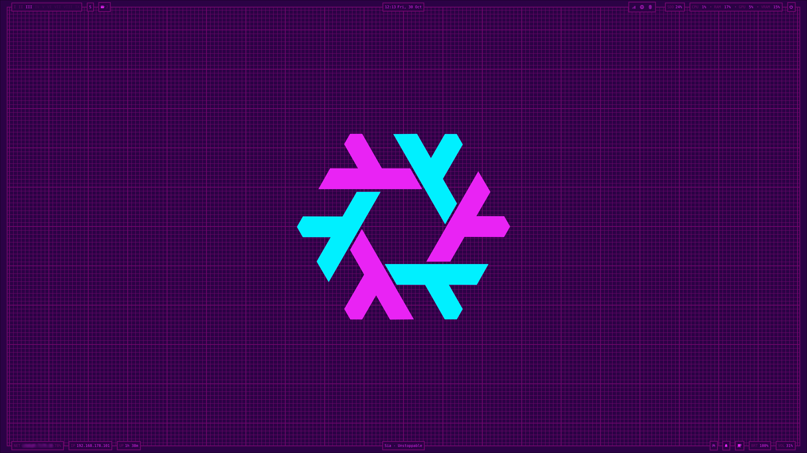
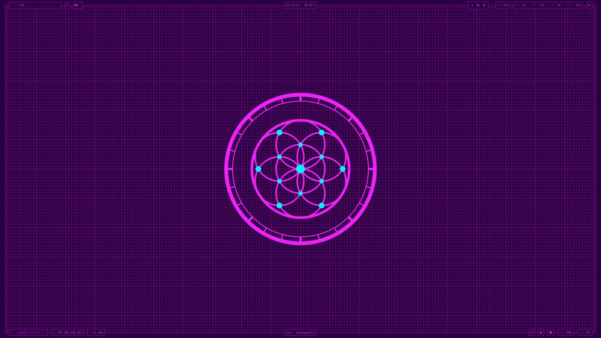

# Tabularium Imperium

A desktop shell for the [mango](https://github.com/DreamMaoMao/mangowc) Wayland
compositor. It is split into two processes: `blueshell`, a Go daemon that talks
to the compositor socket, D-Bus and `/proc`, and a Quickshell UI that renders
the bar, wallpaper, overlays and lock screen. The two communicate over a unix
socket with line-delimited JSON. The QML is embedded in the binary, so a single
package is all you need to install.

Nothing in the shell polls on a timer by spawning processes; widgets are
updated by pushed events, and the backend only samples what visible widgets ask
for.


The same desktop after switching themes, and with a different sigil:




## Features

- Bar with workspaces, clock, CPU/RAM/GPU/VRAM, storage, uptime, network,
  IP address, volume, media, battery, brightness, power profile, keyboard
  layout and mode, system tray
- Wallpaper with a blueprint grid shader and a configurable SVG sigil
- Session lock (`ext-session-lock-v1`) with PAM, optional fingerprint, idle
  locking, lock-before-suspend and a window flyout animation
- Notification server with toasts, a history centre, actions and do not disturb
- Logout panel (lock, sleep, exit, reboot, shutdown); power actions go
  through logind, exit asks the compositor to quit
- On-screen display for volume and brightness
- Caffeine mode that inhibits idle locking and idle suspend
- Live palette changes with a configurable cross-fade, themes via
  [Chromarium-Mechanicus](https://github.com/DerMaista/Chromarium-Mechanicus)
- Theme and sigil pickers
- CLI for everything, suitable for compositor keybinds

## Installation on NixOS

The flake exposes a NixOS module, a home-manager module and the `blueshell`
package. The NixOS module enables UPower and sets up the PAM services the lock
screen uses; the home-manager module runs the shell as a user service bound to
`graphical-session.target`, puts `blueshell` on `PATH` and can write the
config file.

```nix
# flake.nix
{
  inputs = {
    nixpkgs.url = "github:nixos/nixpkgs/nixos-unstable";
    home-manager.url = "github:nix-community/home-manager";
    tabularium-imperium.url = "github:DerMaista/Tabularium-Imperium";
  };

  outputs = { nixpkgs, home-manager, tabularium-imperium, ... }: {
    nixosConfigurations.myhost = nixpkgs.lib.nixosSystem {
      system = "x86_64-linux";
      modules = [
        ./configuration.nix
        tabularium-imperium.nixosModules.default
        home-manager.nixosModules.home-manager
        {
          home-manager.users.me = {
            imports = [ tabularium-imperium.homeManagerModules.default ];

            programs.tabularium-imperium.settings = {
              text.fontsize = 14;
              lock.idleTimeout = 600;
            };
          };
        }
      ];
    };
  };
}
```

`settings` maps one to one onto `~/.config/tabularium-imperium/config.json`.
Keys you leave out keep their defaults, which are listed in
[`src/shell/config/config.json`](src/shell/config/config.json). If `settings`
is empty, the file is not managed and a hand-written one is used instead.

To try it without installing:

```bash
nix run github:DerMaista/Tabularium-Imperium
```

## Usage

Useful commands to bind in mango:

```bash
blueshell lock
blueshell logout toggle
blueshell notifications toggle
blueshell theme toggle
blueshell sigil toggle
blueshell brightness up 5
blueshell caffeine toggle
```

`blueshell --help` lists the rest. `blueshell restart` and `blueshell kill`
control a running instance; only one instance runs per Wayland display.

## Repository layout

```
flake.nix               package, apps, NixOS and home-manager modules
modules/                the NixOS and home-manager modules
packages/blueshell.nix  the Go build, wrapped with its runtime dependencies
src/                    daemon and UI source, see src/README.md
```

## License

MIT
